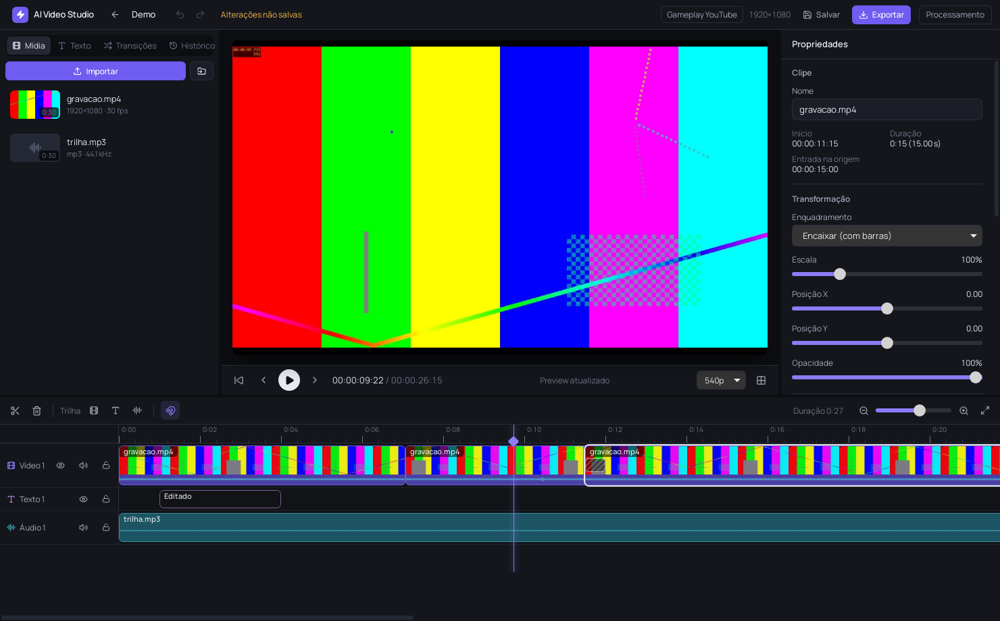

# AI Video Studio

Editor de vídeo desktop, local e não destrutivo, construído para receber edição automática com IA local. Tauri 2 + Rust + React/TypeScript, sobre FFmpeg.



## O que funciona hoje (Fases 1 a 8)

- **Projetos**: criar a partir de 21 presets versionados (16:9, 9:16…), renomear, salvar, excluir; dashboard com thumbnail, duração, resolução, preset, estado e data.
- **Importação** por arquivo, pasta ou arrastar e soltar: validação e metadados com FFprobe (streams, codecs, FPS/timebase, **VFR**, rotação), miniaturas, waveform e proxies em segundo plano. Os originais **nunca são copiados nem alterados**; mídia movida é relocalizada pela impressão digital.
- **Timeline multitrilha** (vídeo, texto, áudio): inserir, mover entre trilhas, aparar início/fim, dividir no cursor, apagar (com ou sem ripple), remover intervalo, duplicar, **ferramentas ripple, roll, slip e slide**, **transições** (dissolver, passar pelo preto, cortina, deslizar), marcadores, ímã, zoom, bloquear/ocultar/silenciar trilhas, miniaturas reais e waveform.
- **Velocidade** (0,25×–4× com áudio sem mudança de tom), **reverso** e **congelar frame**.
- **Keyframes** de zoom, posição e volume (interpolação linear, suave ou degrau), exatos entre blocos de renderização.
- **Cor e efeitos**: brilho, contraste, saturação, temperatura, **LUT 3D (.cube/.3dl)**, desfoque, nitidez e vinheta.
- **Tratamento de áudio por clipe**: corte de graves, redução de ruído, compressor de voz e equalizador de 3 bandas.
- **Legendas**: importar e exportar **SRT/VTT**, editar texto e estilo, "aplicar estilo a todas as legendas".
- **Propriedades**: volume, mudo, fades, opacidade, encaixar/preencher, escala, posição, texto (fonte, tamanho, cores, contorno, caixa, posição).
- **Undo/redo** de tudo, histórico, versões nomeadas (snapshots) e **autosave com recuperação** após fechamento inesperado.
- **Preview WYSIWYG**: o frame do scrubbing e o preview reproduzível vêm do **mesmo compilador** da exportação. O preview se atualiza sozinho, reaproveitando blocos inalterados.
- **Exportação** MP4 H.264/H.265 e WebM VP9, 10 perfis (YouTube, Shorts, Reels, TikTok, LinkedIn…), resolução, qualidade, normalização de loudness e encoders por hardware **testados de verdade**. O arquivo só é marcado como concluído **depois de validado** (resolução, FPS, codec, duração, frames, áudio, sincronismo, decodificação completa, frames pretos e silêncio inesperados).
- **Central de processamento**: progresso real por etapa, tempo decorrido e restante, pausar, continuar, cancelar, repetir, remover; jobs retomados após reiniciar o app.
- **IA local, sem chaves pagas**: Gerenciador de IA instala tudo num Python isolado, com perfis Econômico/Equilibrado/Qualidade conforme o hardware. Inclui detecção de fala (Silero VAD, sem PyTorch), cortes de cena (PySceneDetect), movimento e rostos (OpenCV + YuNet), transcrição com timestamps por palavra (faster-whisper) e cliente do Ollama.
- **Editar automaticamente por preset**: pelo dashboard (escolha os vídeos e um preset) ou na aba IA do editor.
  - Analisa as mídias, pontua os trechos (0–100, com justificativa), remove pausas e hesitações e seleciona para a duração-alvo sem esticar nada.
  - Também aplica legendas, transições nos saltos, zoom pontual na ação, limpeza da fala, música abaixo da fala, fim da trilha com fade e correção de exposição.
  - **Prévia** em vermelho na timeline antes de aplicar, **um único Ctrl+Z**, versões "Original" e "Edição IA vN" salvas automaticamente.
  - **Revisão de qualidade** com "ir para" em cada ponto.
- **Cortes verticais**: sugestão de trechos que se sustentam sozinhos (nota, título e justificativa), cada um criado como projeto 9:16 novo.
  - Enquadramento seguindo o rosto (por planos), central ou com fundo desfocado.
  - Pausas removidas, legendas, áudio tratado e exportação em lote validada, sem alterar o projeto original.
  - Também pela CLI: `avs shorts "Projeto" --count 3 --export ./cortes`.
- **Assistente de edição em português**: "corte de 0:10 a 0:20", "deixe com 30 segundos", "aumente a música em 3 dB", "adicione o texto \"Inscreva-se\" em 0:05"…
  - Plano visível antes, aplicação num único Ctrl+Z.
  - Funciona offline por regras; com o Ollama, aceita pedidos livres, restritos a ações validadas.
- **Ferramentas de IA avulsas**: remover pausas com prévia, marcar/dividir cenas, gerar legendas da transcrição.
- **Gravações longas**:
  - preview por janelas, que reproduz em segundos e não espera renderizar horas;
  - timeline que desenha só o visível;
  - análise de 30 min em ~2 min numa VM de 2 núcleos;
  - paralelismo de renderização limitado pela memória livre.
- **CLI `avs`** com a mesma camada de serviço (automação, CI, benchmarks). `avs bench --minutes 30` mede o fluxo completo numa gravação longa, com pico de memória.
- `AVS_LIBRARY=/caminho` abre o app com outra biblioteca (testes, uso portátil).
- **Testes de interface automatizados** (WebDriver) e **instaladores** para Linux (`.deb`, `.rpm`, AppImage), Windows (NSIS/MSI) e macOS (DMG), com CI e workflow de release.

Ainda **não** implementado (ver `docs/ARCHITECTURE.md` §8): refinamento do plano automático pela LLM local, panorâmica contínua e layouts facecam + gameplay ou tela dividida nos cortes, máscaras, chroma key, estabilização e intercâmbio OpenTimelineIO. A transcrição está implementada, mas precisa ser validada fora do ambiente de desenvolvimento (ver `docs/AI_MODELS.md`). A interface não mostra botões para nada disso: não há recursos simulados.

## Começando

```bash
scripts/install-deps.sh          # ou scripts\install-deps.ps1 no Windows
cd apps/desktop
npm install
npm run tauri dev                # app em modo desenvolvimento
npm run tauri build              # instalador para o seu sistema
```

Requisitos: Rust ≥ 1.80, Node ≥ 20, **FFmpeg ≥ 6** no `PATH` (ou em `AVS_FFMPEG_DIR`, ou empacotado com `scripts/fetch-ffmpeg.*`). Sem FFmpeg, o app avisa na abertura com a mensagem real do erro.

Linha de comando:

```bash
cargo run -p avs-cli --release -- demo --out /tmp/avs-demo --seconds 60   # fluxo completo + benchmark
cargo run -p avs-cli --release -- encoders                                 # testa NVENC/QSV/AMF/VideoToolbox
cargo run -p avs-cli --release -- --help
```

## Verificação

```bash
scripts/verify.sh                 # Rust + frontend + build
xvfb-run -a node e2e/run.mjs      # E2E da interface (Linux; ver docs/TESTING.md)
```

O `verify.sh` roda os testes Rust (204 com `AVS_AI_INTEGRATION=1`), os testes do frontend (13), o typecheck e o build. Os testes Rust incluem integração com o FFmpeg real:
- velocidade, reverso, congelamento, keyframes, LUT e efeitos conferidos pixel a pixel;
- exportação validada e preview idêntico à exportação;
- cache incremental, cancelamento, pausa e retomada;
- recuperação após reinício.

O E2E dirige o app real por WebDriver em 14 cenários, incluindo reprodução real, exportação e recuperação após fechar sem salvar.

## Instaladores

```bash
cd apps/desktop
npm run tauri build -- --bundles deb,rpm,appimage   # Linux (AppImage precisa de patchelf)
npm run tauri build -- --bundles nsis,msi            # Windows
npm run tauri build -- --bundles app,dmg             # macOS
```

- `.deb` e `.rpm` declaram o FFmpeg da distribuição como dependência.
- O AppImage leva o GStreamer junto (para o preview tocar) e usa o FFmpeg do sistema.
- No Windows, o workflow de release empacota o FFmpeg (`scripts/fetch-ffmpeg.ps1`). No macOS, instale com `brew install ffmpeg`: o app o procura também em `/opt/homebrew/bin` e `/usr/local/bin`, pois apps abertos pelo Finder não herdam o PATH do terminal.
- A assinatura usa secrets do GitHub (ver `.github/workflows/release.yml`).

Neste ambiente, foram gerados e testados o `.deb` (instalado), o `.rpm` e o AppImage. Os de Windows e macOS saem do CI.

## Documentação

| Documento | Conteúdo |
|---|---|
| [ARCHITECTURE.md](docs/ARCHITECTURE.md) | arquitetura, stack, diretórios, modelo de dados, contratos, renderização, IA, plano e critérios |
| [DEVELOPMENT.md](docs/DEVELOPMENT.md) | ambiente, comandos, convenções |
| [AI_MODELS.md](docs/AI_MODELS.md) | estratégia de IA local (Fase 3) |
| [PRESETS.md](docs/PRESETS.md) | formato e catálogo de presets |
| [PERFORMANCE.md](docs/PERFORMANCE.md) | benchmarks medidos e otimizações |
| [TESTING.md](docs/TESTING.md) | cobertura e cenários da seção 30 |
| [SECURITY.md](docs/SECURITY.md) | ameaças e mitigações |

## Licenças

Código: Apache-2.0. O FFmpeg é um programa externo: se for distribuído junto com o app, respeite a licença da build usada (builds com libx264/libx265 são GPL). Fontes empacotadas devem ter licença compatível (ex.: Inter e Manrope, OFL).
